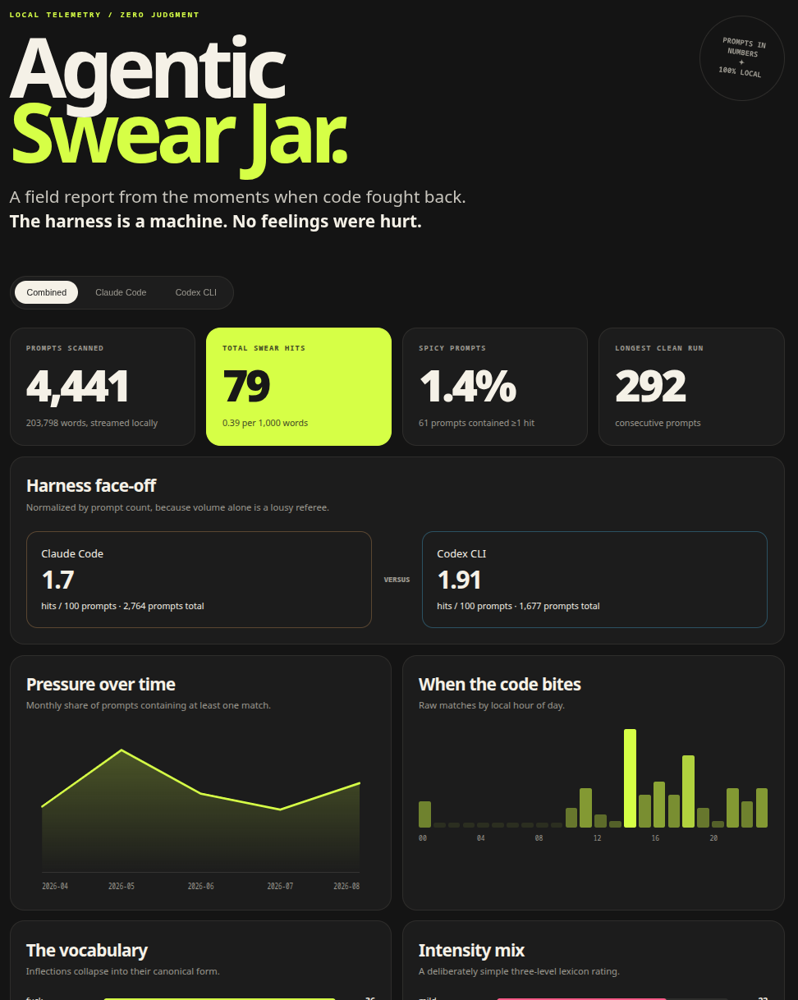

<div align="center">

# 🫙 Agentic Swear Jar

### The code was difficult. The harness is a machine. No biggie. Now there are charts.

**A private, local, zero-AI dashboard for the spicy parts of your Claude Code and Codex CLI history.**

`one command` · `two coding agents` · `zero prompts uploaded`

</div>

---

## Why this matters — and why it is fun

Building software with an agent is still building software. Tests fail, tools loop, the same bug
returns wearing a small fake moustache, and occasionally the most precise technical response is a
four-letter word.

That is not a conduct problem. **A coding harness is a machine. It has no feelings to hurt.** Your
language is simply another trace of the work: a tiny pressure gauge for friction, intensity, late
nights, stubborn projects, and the glorious moment the fix finally lands.

Agentic Swear Jar turns that trace into something worth smiling at. It compares Claude Code with
Codex CLI, finds trends, ranks vocabulary, and produces a polished standalone report. It does all
of this locally with ordinary parsing, Unicode-aware tokenization, dictionary lookups, and
arithmetic. No model judges the language. No API receives the prompts. No raw prompt text goes into
the report.

## Current state




**Author: Marcel Petrick <mail@marcelpetrick.it>**

**License: GPLv3 or later. See `LICENSE`.**

**Note: projected is generated with AI.**

## Make the report

Requirements: Linux and Python 3.10 or newer. There are no runtime dependencies.

```bash
./swear-stats --open
```

That reads both default histories:

| Tool | Default input | Prompt field |
|---|---|---|
| Claude Code | `~/.claude/history.jsonl` | `display` |
| Codex CLI | `~/.codex/history.jsonl` | `text` |

The output is `report.html`, a self-contained file that works offline. If a history is missing, the
tool warns and continues with the one it can find. Use `--strict-inputs` when both are required.

Want aggregate JSON as well?

```bash
./swear-stats --json report.json --output report.html
```

Want a particular era of your life?

```bash
./swear-stats --since 2026-01-01 --until 2026-06-30 --open
```

The dates are inclusive and interpreted in the machine's local timezone.

## What the dashboard extracts

The report has combined, Claude Code, and Codex CLI views. Each includes:

- prompt count, word count, total matches, and prompts containing at least one match;
- matches per 100 prompts and per 1,000 words, so tools with different usage volumes compare fairly;
- daily and monthly trends, local hour-of-day activity, and weekday patterns;
- canonical vocabulary rankings (`fucked`, `fucking`, and `fucks` become `fuck`);
- mild, moderate, and strong intensity counts;
- match rates by prompt-length bucket;
- longest clean and spicy prompt streaks;
- distinct session and Claude project counts, without exposing their identifiers; and
- malformed-record diagnostics, because JSONL occasionally has a bad day too.

The dashboard intentionally does **not** contain prompts, snippets, session IDs, project names, or
project paths.

## How it works

The analyzer streams each JSONL file one line at a time. Every prompt is tokenized once with a
compiled Unicode-aware regular expression. Normalized tokens are checked against an in-memory hash
map, making lookup effectively constant-time. Only counters, date buckets, and tiny timestamp/event
tuples survive analysis.

For an input containing *n* characters and *w* words, the main scan is **O(n + w)**. No prompt text
is retained: memory grows with the number of dates, sessions, and aggregate labels, plus one small
timestamp/flag tuple per dated prompt, which is what the longest-run statistics are folded from. It does not shell out to `grep` or `jq`, so multiline JSON strings, Unicode, and malformed
records are handled consistently in one pass.

Matching is case-insensitive and uses whole tokens. This avoids classic substring mistakes such as
matching `ass` inside `class` or `hell` inside `shell`. Underscores act as separators, which is
useful for identifiers such as `what_the_hell`.

## The English lexicon

There is no universal database of swear words. Meaning depends on geography, context, reclaimed
language, and personal taste; aggressive blocklists also run into the
[Scunthorpe problem](https://en.wikipedia.org/wiki/Scunthorpe_problem). This project therefore ships
a small, transparent English list aimed at ordinary expletives—not hate-speech moderation. It has
four tab-separated columns:

```text
# variant    canonical    category      severity
fucking      fuck         expletive     3
wtf          fuck         abbreviation  2
```

Edit [`swearstats/data/en.tsv`](swearstats/data/en.tsv), or layer personal terms on top without
changing the repository:

```bash
./swear-stats --lexicon my-words.tsv
```

Later files override earlier variants. To discard the bundled English list entirely:

```bash
./swear-stats --replace-lexicon --lexicon my-words.tsv
```

Useful public datasets do exist. The MIT-licensed
[`@dsojevic/profanity-list`](https://github.com/dsojevic/profanity-list) adds severity, exceptions,
and tags; [`cuss`](https://github.com/words/cuss) rates terms by how likely they are to be profane;
and [LDNOOBW](https://github.com/LDNOOBW/List-of-Dirty-Naughty-Obscene-and-Otherwise-Bad-Words)
covers many languages. They are good raw material, but importing a large list blindly will change
the meaning of the statistics and increase false positives. A personal list you understand is
usually more honest.

## Commands

```text
usage: swear-stats [-h] [--claude-history PATH] [--codex-history PATH]
                   [--lexicon TSV] [--replace-lexicon]
                   [--since YYYY-MM-DD] [--until YYYY-MM-DD]
                   [-o PATH] [--json PATH] [--redact-terms]
                   [--open] [--strict-inputs]
```

Examples:

```bash
# Nonstandard config directories
./swear-stats \
  --claude-history /mnt/private/claude/history.jsonl \
  --codex-history /mnt/private/codex/history.jsonl

# Machine-readable aggregates only in addition to HTML
./swear-stats --json build/stats.json --output build/dashboard.html

# Install an isolated CLI for development
python3 -m venv .venv
.venv/bin/pip install -e .
.venv/bin/swear-stats --open
```

## Where those histories come from

This project analyzes the short, global prompt histories rather than full session transcripts, so
each user input is counted once and tool outputs are excluded.

- Anthropic documents `~/.claude/history.jsonl` as every typed prompt with its timestamp and project
  path, retained until deletion. Full transcripts live below `~/.claude/projects/` and are subject
  to `cleanupPeriodDays` (30 days by default). See
  [Explore the `.claude` directory](https://code.claude.com/docs/en/claude-directory).
- OpenAI's Codex source defines `~/.codex/history.jsonl` as append-only JSONL records shaped like
  `{"session_id":"…","ts":1234567890,"text":"…"}`. See the
  [Codex message-history implementation](https://github.com/openai/codex/blob/main/codex-rs/message-history/src/lib.rs).

Both formats are implementation details that may evolve. Unknown or malformed records are skipped
and reported rather than crashing the whole run.

## Privacy notes

The script reads plaintext histories, so treat it with the same access controls as the coding tools
themselves. Generated `report.html` and `report.json` are ignored by Git by default. Although they
contain aggregates only, the canonical-term ranking is still personal information—share it because
it is funny, not by accident.

To stop future local prompt history, consult each tool's current settings. Anthropic documents
`CLAUDE_CODE_SKIP_PROMPT_HISTORY`; Codex supports `[history] persistence = "none"` in its config.
Changing those settings also affects recall and resume behavior, so read the upstream documentation
before flipping the switch.

## Develop and verify

Install the pinned toolchain, then run the same local quality gate used before every commit:

```bash
python3 -m venv .venv
.venv/bin/pip install --group dev
source .venv/bin/activate
./localPipeline.sh
```

The application has no runtime dependencies. The development pipeline expects `shellcheck`, `ruff`,
and `mypy` on `PATH`; it runs the complete test suite, shell and Python linting, formatting checks,
strict type checking, and Git's whitespace validation, stopping at the first failure.

Those three tools are pinned to exact versions in the `dev` dependency group in `pyproject.toml`,
so every machine checks against the same rule sets — a linter minor release can otherwise enable
rules that pass locally and fail elsewhere. `shellcheck-py` ships the `shellcheck` binary as a
wheel; a system-wide `shellcheck` of the same version works just as well. Installing the group
needs pip 25.1 or newer for `--group`.

The test suite covers both history shapes, canonical variants, Unicode-aware whole-word behavior,
date filtering, malformed records, combined statistics, and the promise that raw prompt text and
project paths never enter the HTML.

## Publish the LinkedIn carousel

The repository includes a reproducible public build based on the real Claude Code and Codex CLI
histories:

```bash
./buildPublicArtifacts.sh
```

It requires Chromium and `img2pdf`, then creates and updates:

- `public/report.html` — the interactive, redacted dashboard;
- `public/report.json` — aggregate data behind every published number;
- `public/linkedin-carousel.html` — four-slide carousel source;
- `public/slides/` — four 1080×1080 RGB screenshots; and
- `public/agentic-swear-jar-linkedin.pdf` — the square, four-page LinkedIn document.

The complete `public/` directory is generated locally and ignored by Git. Rebuilding it never stages
personal statistics or publication files by accident.

The public build uses `--redact-terms`: observed vocabulary retains its first character for visual
rhythm, while every remaining character becomes a solid marker block. The carousel builder refuses
unredacted JSON. Raw prompts, project paths, session IDs, and uncensored observed terms are not
published.

## Limits, honestly stated

- This is exact lexical matching, not contextual language understanding.
- It will miss creative punctuation, deliberate obfuscation, and novel spellings.
- It can count a quoted swear word or code identifier even when the prompt is discussing the word.
- Severity is editorial metadata, not science.
- Missing or disabled history cannot be reconstructed.
- Counts answer “what matched this list?”—not “was this prompt offensive?” Those are very different
  questions, and this project only claims the first.

---

<div align="center">

**May your tests be green and your vocabulary statistically significant.**

Copyright © 2026 Marcel Petrick. Licensed under the
[GNU General Public License v3.0 only](LICENSE).

</div>
